# Deploying a Web App to AKS with Helm

**Status:** 🚧 In progress — build complete and torn down; video walkthrough pending

## 🎬 Video Walkthrough

<!-- LOOM LINK: added after the build -->
_Video walkthrough coming soon._

## 📖 Project Overview

An app that runs perfectly on one laptop drifts the moment it has to run in dev, staging, and production. Replica counts differ, a database URL gets hand-edited in one place, someone patches YAML directly in production and never writes it down. Deployments become unreproducible, and rolling back means trying to remember what the previous state was.

In this project I packaged a web application as a Helm chart and deployed it to Azure Kubernetes Service (AKS). The chart declares every Kubernetes object the app needs: Deployment, Service, Ingress, ConfigMap, Secret, health probes, resource limits, and a Horizontal Pod Autoscaler. The only thing that changes between environments is one values file. Every install and upgrade is a numbered revision, so I can roll back the entire release with one command.

The two tools own separate layers. Terraform provisions the platform (resource group and AKS cluster). Helm deploys the application into it. The kubeconfig written by `az aks get-credentials` is the handoff between them, which keeps cluster credentials out of Terraform state.

### Skills Demonstrated

- Provisioning a managed Kubernetes cluster (AKS) with Terraform (azurerm 4.x)
- Installing a third-party Helm chart (an ingress controller) with `--set` overrides
- Writing a Helm chart by hand: `Chart.yaml`, `values.yaml`, named-template helpers, and conditional templates
- Kubernetes fundamentals: Deployments, Services, Ingress, ConfigMaps, Secrets, liveness/readiness probes, requests/limits, HPA
- Config-checksum annotations that roll pods automatically when configuration changes
- Release lifecycle management: `helm upgrade --install`, `helm history`, `helm rollback`, `helm package`
- Azure load balancer health-probe behavior for Kubernetes `LoadBalancer` Services

## 🏗️ Architecture Diagram

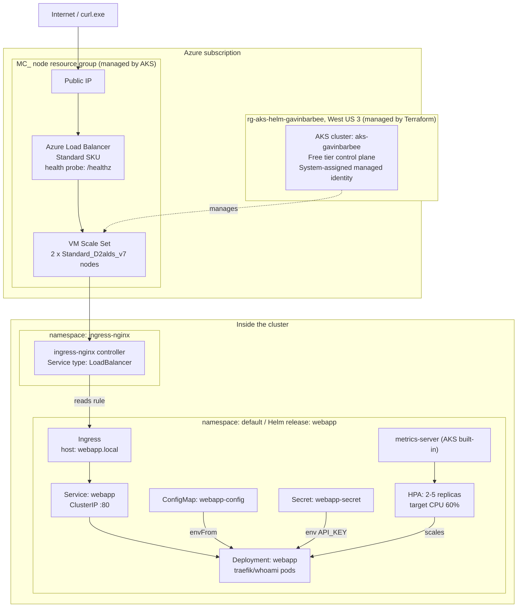

**Deployment workflow — Terraform provisions, Helm deploys:**

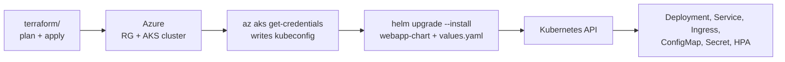

## ✅ Prerequisites

- An Azure subscription where you have Contributor (or Owner)
- Windows with PowerShell and VS Code
- [Azure CLI](https://learn.microsoft.com/cli/azure/install-azure-cli) and [Terraform](https://developer.hashicorp.com/terraform/install)
- `kubectl` and `helm`, installed with winget:

```powershell
winget install -e --id Kubernetes.kubectl
winget install -e --id Helm.Helm
kubectl version --client
helm version
```

If `kubectl` or `helm` is "not recognized" right after installing, close and reopen PowerShell so the PATH refreshes. `az aks install-cli` is a fallback that installs kubectl.

Log in and confirm the active subscription:

```powershell
az login
az account show
```

## 🏷️ Naming Conventions

| Resource | Name | Created by |
|---|---|---|
| Resource group | `rg-aks-helm-gavinbarbee` | Terraform |
| AKS cluster | `aks-gavinbarbee` | Terraform |
| AKS DNS prefix | `aks-gavinbarbee` | Terraform |
| Node pool | `system` (2 x `Standard_D2alds_v7`) | Terraform |
| Node resource group | `MC_rg-aks-helm-gavinbarbee_aks-gavinbarbee_westus3` | AKS (automatic) |
| Ingress controller release | `ingress-nginx` (namespace `ingress-nginx`) | Helm |
| App release | `webapp` (namespace `default`) | Helm |
| App objects | `webapp`, `webapp-config`, `webapp-secret` | Helm chart |

## 🪜 Project Steps

### Step 1 — Create the project folder

```powershell
cd "$env:OneDrive\Desktop"
mkdir azure-aks-helm-deployment
cd azure-aks-helm-deployment
mkdir terraform
```

The Terraform files go in `terraform/`. The Helm chart gets its own folder in Step 7.

> If `terraform init` or `apply` fails with a "file in use" error, pause OneDrive sync for the duration of the build.

### Step 2 — Pre-flight check: VM size availability and quota

My original plan was two `Standard_B2s` nodes in East US, the cheapest size that meets AKS's hard floor for a system node pool (2 vCPUs, 4 GB RAM). Before provisioning anything, I checked that the size was actually deployable. That check changed both the size and the region.

**Quota looked fine.** East US showed 10 BS-family vCPUs available, more than the 4 that two nodes need:

```powershell
az vm list-usage --location eastus --output table | Select-String "Total Regional vCPUs|Standard BS Family"
```

**But the size itself was blocked.** By default, `az vm list-skus` hides sizes your subscription can't use, so I added `--all` to see restricted sizes and the reason. `Standard_B2s` showed `NotAvailableForSubscription` at the location level and in every zone, and `Standard_D2s_v3` came back the same way.

```powershell
az vm list-skus --location eastus --size Standard_B2s --all --output table
az vm list-skus --location eastus --size Standard_D2s_v3 --all --output table
```

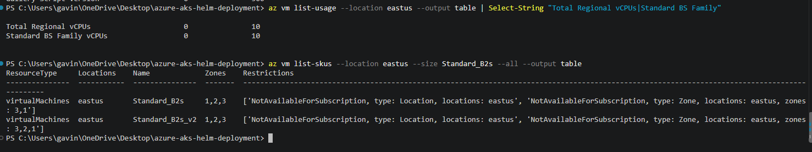

**The restriction wasn't specific to East US.** Checking four more regions, both sizes were blocked everywhere, while newer-generation sizes were open:

```powershell
foreach ($r in "westus2","westus3","eastus2","centralus") { az vm list-skus --location $r --size Standard_B2s --all --output table; az vm list-skus --location $r --size Standard_D2s_v3 --all --output table }
az vm list-skus --location westus3 --size Standard_D2 --output table
```

**What I picked:** `Standard_D2alds_v7`, first in Central US. I confirmed both gates, availability (`Restrictions: None`) and family quota (10 Daldsv7 vCPUs available), before writing it into Terraform. Central US later failed at cluster creation for a different reason, covered in Step 4, and the final region is West US 3.

```powershell
az vm list-skus --location centralus --size Standard_D2alds_v7 --all --output table
az vm list-usage --location centralus --output table | Select-String "Total Regional vCPUs|Daldsv7"
```

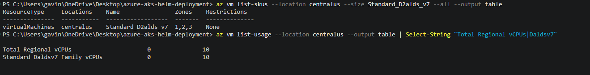

> **About this size:** `Standard_D2alds_v7` has 2 vCPUs and 4 GiB of memory, the same footprint as the B2s I planned, on AMD EPYC. It isn't burstable, so it also avoids Microsoft's recommendation against B-series VMs for system node pools. It's a Generation 2-only size that requires NVMe-capable OS images; AKS selects a Gen 2 node image automatically for Linux pools. 4 GiB is still tight once system pods, the ingress controller, and the app share each node, which is acceptable for a short-lived lab.

### Step 3 — Write the Terraform

**`terraform/variables.tf`** — the node pool is small and cheap, and its size and count are parameterized so it can scale later. `subscription_id` is a variable because the azurerm 4.x provider requires it explicitly.

```hcl
variable "subscription_id" {
  description = "Azure subscription ID. Required by the azurerm 4.x provider."
  type        = string
}

variable "yourname" {
  description = "Your name, lowercase, no spaces. Makes resource names unique."
  type        = string
}

variable "location" {
  description = "Azure region to deploy into."
  type        = string
  default     = "West US 3"
}

variable "node_count" {
  description = "Number of worker nodes in the system pool."
  type        = number
  default     = 2
}

variable "vm_size" {
  description = "VM size for each node. 2 vCPU / 4 GiB, available and within quota for this subscription."
  type        = string
  default     = "Standard_D2alds_v7"
}

variable "tags" {
  type = map(string)
  default = {
    project     = "aks-helm"
    environment = "dev"
    managed_by  = "terraform"
  }
}
```

**`terraform/terraform.tfvars.example`** — committed with placeholder values. The real `terraform.tfvars` is gitignored.

```hcl
subscription_id = "00000000-0000-0000-0000-000000000000"
yourname        = "gavinbarbee"
location        = "West US 3"
```

Create the real file from the example, then replace the placeholder with your subscription ID. The second command prints it.

```powershell
cd terraform
Copy-Item terraform.tfvars.example terraform.tfvars
az account show --query id -o tsv
```

**`terraform/main.tf`** — only the azurerm provider is needed. Because `az aks get-credentials` wires up kubectl after the cluster exists, Terraform never handles the kubeconfig, which keeps cluster credentials out of state. `identity { type = "SystemAssigned" }` lets the cluster create Azure resources on its own, such as the load balancer the ingress controller requests later. `sku_tier = "Free"` keeps the managed control plane free, so only the nodes are billed.

```hcl
terraform {
  required_providers {
    azurerm = {
      source  = "hashicorp/azurerm"
      version = "~> 4.0"
    }
  }
}

provider "azurerm" {
  features {}
  subscription_id = var.subscription_id
}

resource "azurerm_resource_group" "main" {
  name     = "rg-aks-helm-${var.yourname}"
  location = var.location
  tags     = var.tags
}

resource "azurerm_kubernetes_cluster" "main" {
  name                = "aks-${var.yourname}"
  location            = azurerm_resource_group.main.location
  resource_group_name = azurerm_resource_group.main.name
  dns_prefix          = "aks-${var.yourname}"
  sku_tier            = "Free"

  default_node_pool {
    name       = "system"
    node_count = var.node_count
    vm_size    = var.vm_size

    # AKS fills in max_surge = "10%" on its own; declaring it keeps plans converged.
    upgrade_settings {
      max_surge = "10%"
    }
  }

  identity {
    type = "SystemAssigned"
  }

  tags = var.tags
}
```

**`terraform/outputs.tf`** — the most useful output is the exact command that points kubectl at the new cluster.

```hcl
output "resource_group_name" {
  value = azurerm_resource_group.main.name
}

output "cluster_name" {
  value = azurerm_kubernetes_cluster.main.name
}

output "get_credentials_command" {
  description = "Run this to point kubectl at the new cluster."
  value       = "az aks get-credentials --resource-group ${azurerm_resource_group.main.name} --name ${azurerm_kubernetes_cluster.main.name} --overwrite-existing"
}
```

### Step 4 — Deploy the cluster

From the `terraform/` folder, using a saved plan so what gets applied is exactly what I reviewed:

```powershell
terraform init
terraform plan "-out=main.tfplan"
terraform apply main.tfplan
```

The plan should show 2 resources to add (the resource group and the cluster). AKS takes several minutes to provision.

**Finding: AKS capacity is a third, separate gate.** My first apply, in Central US, created the resource group and then failed on the cluster with `400 AKSCapacityHeavyUsage`: AKS wasn't accepting new clusters in that region. VM size availability and quota had both passed, and there's no CLI check for AKS capacity ahead of time.

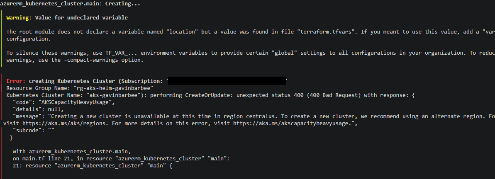

Before re-planning, I confirmed the failed create hadn't left a half-built cluster behind, and checked Daldsv7 quota in West US 3, where the earlier listing already showed `Standard_D2alds_v7` unrestricted:

```powershell
az aks list --resource-group rg-aks-helm-gavinbarbee --output table
az vm list-usage --location westus3 --output table | Select-String "Total Regional vCPUs|Daldsv7"
```

I then set `location = "West US 3"` in `terraform.tfvars` and re-planned. Azure locations are immutable, so the plan replaced the still-empty resource group (`-/+`, `# forces replacement`) and created the cluster: `2 to add, 0 to change, 1 to destroy`. That apply succeeded.

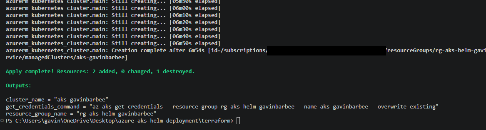

**Finding: the first post-apply plan wasn't clean.** Running `terraform plan` right after the apply, which should report no changes, showed an in-place update removing `default_node_pool.upgrade_settings` (`max_surge = "10%" -> null`). AKS sets that surge default itself. Because my config didn't declare the block, Terraform would strip it on every apply and Azure would put it back, so the plan would never converge. I declared the value AKS uses (the `upgrade_settings` block in `main.tf` above) instead of applying the diff, then confirmed the plan came back clean:

```powershell
terraform plan
```

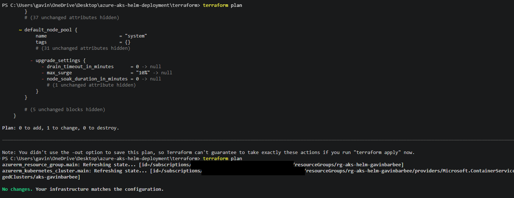

### Step 5 — Connect kubectl to the cluster

Print the credentials command from the Terraform output, run it, then confirm both nodes are `Ready`:

```powershell
terraform output -raw get_credentials_command
az aks get-credentials --resource-group rg-aks-helm-gavinbarbee --name aks-gavinbarbee --overwrite-existing
kubectl get nodes
cd ..
```

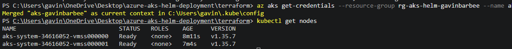

### Step 6 — Install the ingress controller (first Helm install)

The cluster needs an ingress controller before the app can be reached from the internet. I installed the ingress-nginx controller from its Helm chart repository, passing overrides with `--set`.

```powershell
helm repo add ingress-nginx https://kubernetes.github.io/ingress-nginx
helm repo update
helm install ingress-nginx ingress-nginx/ingress-nginx --namespace ingress-nginx --create-namespace --set controller.service.type=LoadBalancer --set 'controller.service.annotations.service\.beta\.kubernetes\.io/azure-load-balancer-health-probe-request-path=/healthz'
```

Setting the controller Service to `LoadBalancer` makes AKS provision an Azure load balancer and public IP in the `MC_` node resource group.

**Why the health-probe annotation:** Azure's load balancer health-probes the controller over HTTP at `/` by default. ingress-nginx answers `/` with a 404 when no Ingress host matches, and the probe request doesn't carry the `webapp.local` Host header. Without the annotation, the load balancer marks every node unhealthy and requests to the public IP time out, even though the IP is assigned. Pointing the probe at the controller's `/healthz` endpoint fixes this. The single quotes keep PowerShell from mangling the escaped dots in the annotation key.

**A note on ingress-nginx:** the Kubernetes project retired ingress-nginx in March 2026. The chart and images are still published, but there will be no further releases or security patches. I used it here because this cluster exists for a few hours and is torn down afterward, and because the chart itself is controller-agnostic. The app's Ingress only references `ingress.className`, so moving to a maintained controller or to Gateway API changes the controller install and one value, not the chart. I wouldn't deploy ingress-nginx into a long-lived environment today.

Confirm the annotation landed, then watch for the external IP (Ctrl+C once it changes from `<pending>` to an address):

```powershell
kubectl get service ingress-nginx-controller -n ingress-nginx -o jsonpath="{.metadata.annotations}"
kubectl get service ingress-nginx-controller -n ingress-nginx -w
```

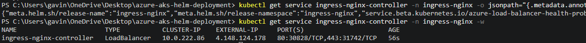

### Step 7 — Write the Helm chart

I wrote each file by hand rather than scaffolding with `helm create`, so every line is something I can explain. From the project root:

```powershell
mkdir webapp-chart\templates
```

#### 7.1 `webapp-chart/Chart.yaml`

The chart's identity card. `version` is the version of the packaging; `appVersion` is the version of the application inside it. They move independently. Fixing a template typo bumps `version` without touching `appVersion`.

```yaml
apiVersion: v2
name: webapp
description: A Helm chart that packages a stateless web app for Kubernetes
type: application
version: 0.1.0
appVersion: "1.0"
```

#### 7.2 `webapp-chart/values.yaml`

The one file that changes per environment. Templates read from it; to deploy to staging vs. production you change values, not templates. The app is `traefik/whoami`, which returns a page showing which pod served the request. That makes Service load-balancing visible.

```yaml
replicaCount: 2

image:
  repository: traefik/whoami
  tag: "v1.10.2"
  pullPolicy: IfNotPresent

nameOverride: ""
fullnameOverride: ""

service:
  type: ClusterIP
  port: 80

ingress:
  enabled: true
  className: nginx
  host: webapp.local
  path: /
  pathType: Prefix

resources:
  requests:
    cpu: 50m
    memory: 64Mi
  limits:
    cpu: 200m
    memory: 128Mi

probes:
  path: /

config:
  WELCOME_MESSAGE: "Hello from Helm on AKS"

secret:
  apiKey: "change-this-please"

autoscaling:
  enabled: true
  minReplicas: 2
  maxReplicas: 5
  targetCPUUtilizationPercentage: 60
```

> The `apiKey` here is a placeholder and must stay one. Values files get committed, and `helm template` prints `stringData` in plain text. A real secret would be passed at install time or pulled from Azure Key Vault.

#### 7.3 `webapp-chart/templates/_helpers.tpl`

Named templates are the chart's functions: names and labels are defined once and included everywhere. The `fullname` logic is the standard Helm pattern that avoids names like `webapp-webapp` when the release name already contains the chart name.

```yaml
{{- define "webapp.name" -}}
{{- default .Chart.Name .Values.nameOverride | trunc 63 | trimSuffix "-" -}}
{{- end -}}

{{- define "webapp.fullname" -}}
{{- if .Values.fullnameOverride -}}
{{- .Values.fullnameOverride | trunc 63 | trimSuffix "-" -}}
{{- else -}}
{{- $name := default .Chart.Name .Values.nameOverride -}}
{{- if contains $name .Release.Name -}}
{{- .Release.Name | trunc 63 | trimSuffix "-" -}}
{{- else -}}
{{- printf "%s-%s" .Release.Name $name | trunc 63 | trimSuffix "-" -}}
{{- end -}}
{{- end -}}
{{- end -}}

{{- define "webapp.labels" -}}
app.kubernetes.io/name: {{ include "webapp.name" . }}
app.kubernetes.io/instance: {{ .Release.Name }}
app.kubernetes.io/managed-by: {{ .Release.Service }}
helm.sh/chart: {{ printf "%s-%s" .Chart.Name .Chart.Version }}
{{- end -}}

{{- define "webapp.selectorLabels" -}}
app.kubernetes.io/name: {{ include "webapp.name" . }}
app.kubernetes.io/instance: {{ .Release.Name }}
{{- end -}}
```

#### 7.4 `webapp-chart/templates/deployment.yaml`

This is where the core concepts converge:

- Replicas come from values, unless the HPA owns them.
- Config is injected from the ConfigMap, and the secret from the Secret.
- The liveness probe tells Kubernetes when to restart a pod; the readiness probe tells it when to stop sending the pod traffic.
- Requests and limits drive both scheduling and protection against a runaway pod.
- The `checksum/config` annotation hashes the ConfigMap into the pod template, so a config change rolls the pods automatically instead of sitting unused until the next deploy.

```yaml
apiVersion: apps/v1
kind: Deployment
metadata:
  name: {{ include "webapp.fullname" . }}
  labels:
    {{- include "webapp.labels" . | nindent 4 }}
spec:
  {{- if not .Values.autoscaling.enabled }}
  replicas: {{ .Values.replicaCount }}
  {{- end }}
  selector:
    matchLabels:
      {{- include "webapp.selectorLabels" . | nindent 6 }}
  template:
    metadata:
      labels:
        {{- include "webapp.selectorLabels" . | nindent 8 }}
      annotations:
        checksum/config: {{ include (print $.Template.BasePath "/configmap.yaml") . | sha256sum }}
    spec:
      containers:
        - name: {{ .Chart.Name }}
          image: "{{ .Values.image.repository }}:{{ .Values.image.tag }}"
          imagePullPolicy: {{ .Values.image.pullPolicy }}
          ports:
            - name: http
              containerPort: 80
          envFrom:
            - configMapRef:
                name: {{ include "webapp.fullname" . }}-config
          env:
            - name: API_KEY
              valueFrom:
                secretKeyRef:
                  name: {{ include "webapp.fullname" . }}-secret
                  key: apiKey
          livenessProbe:
            httpGet:
              path: {{ .Values.probes.path }}
              port: http
            initialDelaySeconds: 5
            periodSeconds: 10
          readinessProbe:
            httpGet:
              path: {{ .Values.probes.path }}
              port: http
            initialDelaySeconds: 3
            periodSeconds: 5
          resources:
            {{- toYaml .Values.resources | nindent 12 }}
```

`toYaml` renders a block of values as YAML, and `nindent` indents it to fit where it's inserted.

#### 7.5 `webapp-chart/templates/service.yaml`

Pods are disposable and their IPs change. The Service is the stable in-cluster address, and it load-balances across whichever pods match its selector. The selector reuses the same `selectorLabels` helper the Deployment stamps on its pods, which is why the Service finds the right pods.

```yaml
apiVersion: v1
kind: Service
metadata:
  name: {{ include "webapp.fullname" . }}
  labels:
    {{- include "webapp.labels" . | nindent 4 }}
spec:
  type: {{ .Values.service.type }}
  selector:
    {{- include "webapp.selectorLabels" . | nindent 4 }}
  ports:
    - name: http
      port: {{ .Values.service.port }}
      targetPort: http
```

#### 7.6 `webapp-chart/templates/ingress.yaml`

The external HTTP entry point: requests for this host go to this Service. The whole object is wrapped in an `if`, so toggling one value makes it appear or disappear.

```yaml
{{- if .Values.ingress.enabled -}}
apiVersion: networking.k8s.io/v1
kind: Ingress
metadata:
  name: {{ include "webapp.fullname" . }}
  labels:
    {{- include "webapp.labels" . | nindent 4 }}
spec:
  ingressClassName: {{ .Values.ingress.className }}
  rules:
    - host: {{ .Values.ingress.host | quote }}
      http:
        paths:
          - path: {{ .Values.ingress.path }}
            pathType: {{ .Values.ingress.pathType }}
            backend:
              service:
                name: {{ include "webapp.fullname" . }}
                port:
                  number: {{ .Values.service.port }}
{{- end }}
```

#### 7.7 `webapp-chart/templates/configmap.yaml`

Non-secret configuration. `toYaml` turns the whole `config` map into the ConfigMap's data, so adding a setting is a one-line change in `values.yaml`.

```yaml
apiVersion: v1
kind: ConfigMap
metadata:
  name: {{ include "webapp.fullname" . }}-config
  labels:
    {{- include "webapp.labels" . | nindent 4 }}
data:
  {{- toYaml .Values.config | nindent 2 }}
```

#### 7.8 `webapp-chart/templates/secret.yaml`

`stringData` takes the plain value and Kubernetes base64-encodes it. A Kubernetes Secret is only base64-encoded, not encrypted, by default. Real workloads should enable encryption at rest and source secrets from a manager such as Azure Key Vault via the Secrets Store CSI driver.

```yaml
apiVersion: v1
kind: Secret
metadata:
  name: {{ include "webapp.fullname" . }}-secret
  labels:
    {{- include "webapp.labels" . | nindent 4 }}
type: Opaque
stringData:
  apiKey: {{ .Values.secret.apiKey | quote }}
```

#### 7.9 `webapp-chart/templates/hpa.yaml`

The HPA adds or removes replicas to hit a CPU utilization target, measured as a percentage of the pod's CPU *request*, which is why the Deployment must declare one. AKS ships metrics-server by default, so it supplies the numbers without any extra setup.

```yaml
{{- if .Values.autoscaling.enabled }}
apiVersion: autoscaling/v2
kind: HorizontalPodAutoscaler
metadata:
  name: {{ include "webapp.fullname" . }}
  labels:
    {{- include "webapp.labels" . | nindent 4 }}
spec:
  scaleTargetRef:
    apiVersion: apps/v1
    kind: Deployment
    name: {{ include "webapp.fullname" . }}
  minReplicas: {{ .Values.autoscaling.minReplicas }}
  maxReplicas: {{ .Values.autoscaling.maxReplicas }}
  metrics:
    - type: Resource
      resource:
        name: cpu
        target:
          type: Utilization
          averageUtilization: {{ .Values.autoscaling.targetCPUUtilizationPercentage }}
{{- end }}
```

#### 7.10 `webapp-chart/templates/NOTES.txt`

Printed after every install or upgrade. It's a template too, so it renders the correct next steps for this specific release.

```text
Release {{ .Release.Name }} deployed.
{{- if .Values.ingress.enabled }}

Your app is exposed via Ingress on host: {{ .Values.ingress.host }}

1. Get the ingress controller's external IP:
   kubectl get service ingress-nginx-controller -n ingress-nginx

2. Reach the app (the Host header is what routes you):
   curl.exe -H "Host: {{ .Values.ingress.host }}" http://<EXTERNAL-IP>
{{- else }}

Port-forward to reach the app locally:
   kubectl port-forward svc/{{ include "webapp.fullname" . }} 8080:{{ .Values.service.port }}
{{- end }}
```

#### 7.11 `webapp-chart/.helmignore`

```text
.git
.DS_Store
*.tmp
*.bak
```

### Step 8 — Lint the chart

From the project root:

```powershell
helm lint ./webapp-chart
```

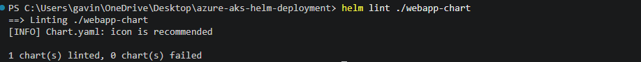

### Step 9 — Render the templates locally

`helm template` runs the templating engine and prints the final Kubernetes YAML without touching the cluster, so every `{{ ... }}` can be checked as a concrete value.

```powershell
helm template webapp ./webapp-chart
```

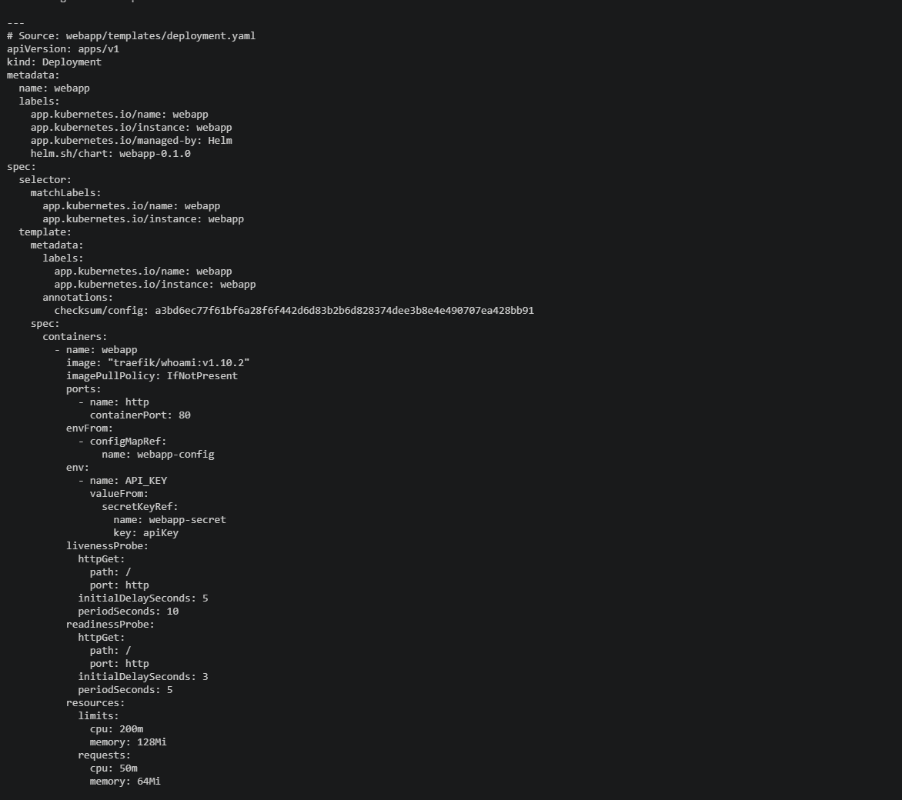

### Step 10 — Install the release

`upgrade --install` installs the release if it doesn't exist and upgrades it if it does, so the same command works every time.

```powershell
helm upgrade --install webapp ./webapp-chart
kubectl get pods,svc,ingress,hpa
```

Expected: running pods, one Service, one Ingress, and the HPA.

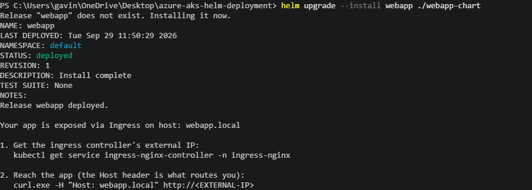

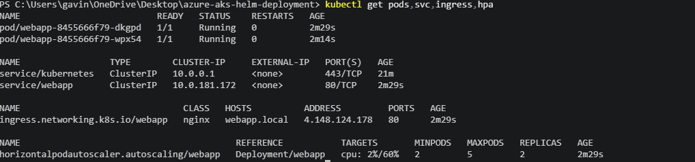

### Step 11 — Reach the app

Get the ingress controller's public IP, then call the app through it. The chart routes on the host `webapp.local`, which isn't in public DNS, so I send it as a Host header. I use `curl.exe` explicitly, because `curl` in Windows PowerShell 5.1 is an alias for `Invoke-WebRequest`, which doesn't accept `-H`.

```powershell
kubectl get service ingress-nginx-controller -n ingress-nginx
curl.exe -H "Host: webapp.local" http://<EXTERNAL-IP>
```

Running it several times shows the `Hostname` changing as the Service load-balances across replicas:

```powershell
1..6 | ForEach-Object { curl.exe -s -H "Host: webapp.local" http://<EXTERNAL-IP> | Select-String "Hostname" }
```

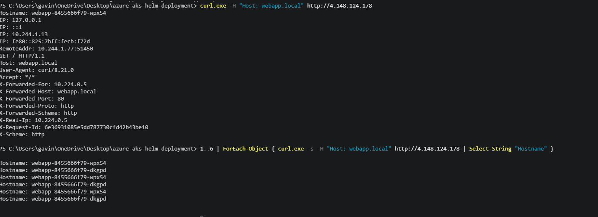

### Step 12 — Upgrade the release

Change values with `--set` and upgrade:

```powershell
helm upgrade --install webapp ./webapp-chart --set replicaCount=3 --set 'config.WELCOME_MESSAGE=Updated via Helm upgrade'
```

Because autoscaling is enabled, the HPA controls the final replica count and `replicaCount` has no direct effect. Setting `autoscaling.enabled=false` would let it take effect.

whoami's page doesn't display environment variables, so I verified the config change in the cluster instead. The ConfigMap holds the new value, and the pods were replaced (new names, fresh `AGE`) by the checksum annotation:

```powershell
kubectl get configmap webapp-config -o yaml
kubectl get pods
```

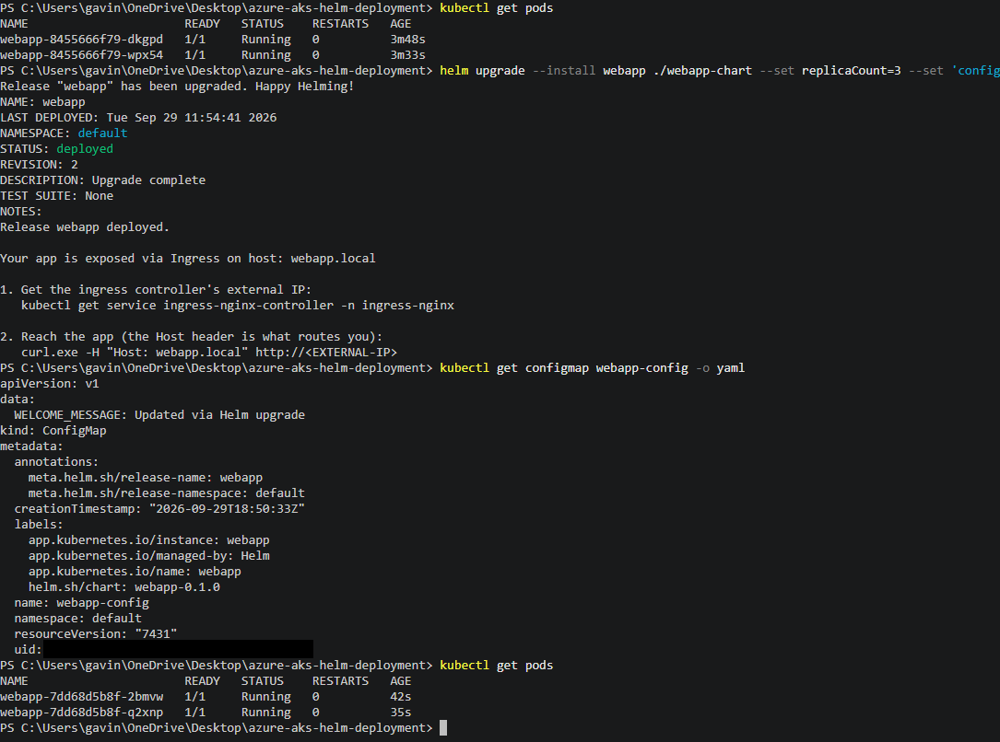

### Step 13 — Inspect the release history

Every install and upgrade is a numbered revision, which serves as both an audit trail and an undo stack.

```powershell
helm history webapp
```

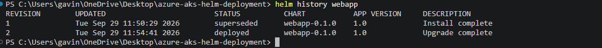

### Step 14 — Roll back

```powershell
helm rollback webapp 1
helm history webapp
kubectl get configmap webapp-config -o yaml
kubectl get pods
```

The history gains a new revision recording the rollback to revision 1, and the ConfigMap is back to the original message. The replacement pods carry the same ReplicaSet hash as revision 1 (`8455666f79`), because the rolled-back pod template, including the config checksum, is identical to the original.

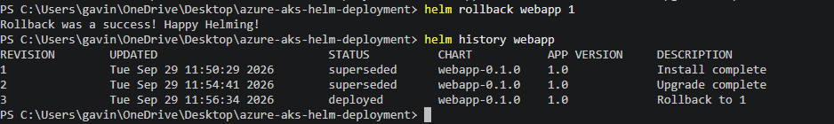

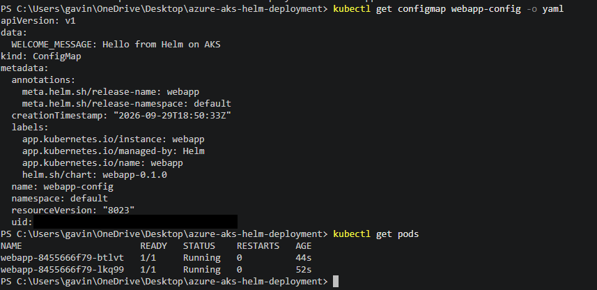

### Step 15 — Watch the autoscaler (optional)

whoami uses almost no CPU, so the HPA sits at its minimum. To see it react, I generated load from inside the cluster in one terminal while watching the HPA in another.

Terminal 1:

```powershell
kubectl get hpa webapp -w
```

Terminal 2:

```powershell
kubectl run -it --rm load --image=busybox --restart=Never -- /bin/sh -c "while true; do wget -q -O- http://webapp/; done"
```

**Result:** with a single load pod running, CPU climbed from 2% to 45% of the pods' CPU request over about two minutes, but never crossed the 60% target, so the HPA correctly held at 2 replicas. The HPA only adds pods when average utilization exceeds the target; one `wget` loop against a service as light as whoami wasn't enough load to trigger a scale-out. Getting one would take more concurrent load, such as additional load pods, or a lower target.

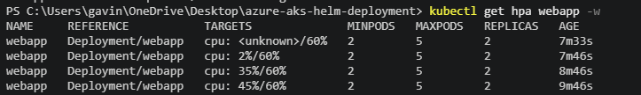

### Step 16 — Package the chart

```powershell
helm package ./webapp-chart
```

This produces `webapp-0.1.0.tgz`, versioned from `Chart.yaml`: one file that is a complete, reproducible deployment of the app, ready to push to a chart repository or to ACR as an OCI artifact. (It's gitignored as a build artifact.)

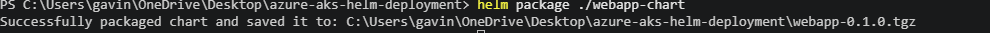

## Verification Checklist

- [x] `kubectl get nodes` shows two nodes in `Ready`
- [x] `kubectl get service ingress-nginx-controller -n ingress-nginx` shows a real `EXTERNAL-IP`, and its annotations include the `/healthz` probe path
- [x] `helm lint ./webapp-chart` reports 0 failures
- [x] `helm template webapp ./webapp-chart` renders concrete YAML with no `{{ }}` left over
- [x] `helm upgrade --install webapp ./webapp-chart` succeeds and prints the NOTES.txt instructions
- [x] `kubectl get pods,svc,ingress,hpa` shows running pods, one Service, one Ingress, and the HPA
- [x] `curl.exe -H "Host: webapp.local" http://<EXTERNAL-IP>` returns a whoami page, and the hostname varies across calls
- [x] After the upgrade, the ConfigMap shows the new message and the pods have rolled
- [x] `helm history webapp` lists numbered revisions
- [x] `helm rollback webapp 1` adds a new revision recording the rollback, and the ConfigMap reverts
- [x] `helm package ./webapp-chart` produces `webapp-0.1.0.tgz`

## 🛠️ Troubleshooting

<!-- Only issues actually hit during the build go here. -->

| Error / Symptom | Cause | Resolution |
|---|---|---|
| `az vm list-skus` returned nothing for `Standard_B2s` in East US; with `--all` it showed `NotAvailableForSubscription` (type: Location), even though BS-family quota showed 10 vCPUs available | SKU availability and quota are separate gates. This subscription is blocked from `Standard_B2s` and `Standard_D2s_v3` in every region I checked (East US, East US 2, West US 2, West US 3, Central US), while newer-generation sizes are open | Found an unrestricted size with `az vm list-skus` (no `--all`, so only usable sizes appear), confirmed its family quota, and switched to `Standard_D2alds_v7` in Central US before running any Terraform |
| Cluster create failed with `400 AKSCapacityHeavyUsage`: creating a new cluster was unavailable in `centralus` | AKS control-plane capacity in the region, independent of VM size availability and quota (both had passed) | Confirmed no failed cluster was left behind with `az aks list`, checked VM family quota in West US 3, changed `location`, and re-planned. The empty resource group was replaced because Azure locations are immutable |
| Post-apply `terraform plan` showed `~ update in-place` removing `default_node_pool.upgrade_settings` (`max_surge = "10%" -> null`) | AKS sets a default surge value that wasn't declared in my config, a known azurerm provider behavior, so the plan would never converge | Didn't apply the diff; declared `upgrade_settings { max_surge = "10%" }` in `default_node_pool` to match what AKS set, then re-ran `terraform plan` until it reported no changes |

## 🧹 Cleanup

AKS nodes and the ingress load balancer bill by the hour. Uninstalling the Helm releases first is optional, because destroying the cluster removes everything, including the auto-created `MC_` node resource group that holds the load balancer, public IP, and node disks.

```powershell
helm uninstall webapp
helm uninstall ingress-nginx -n ingress-nginx
cd terraform
terraform destroy
```

Confirm both resource groups are gone (an empty result means they are):

```powershell
az group list --query "[?contains(name, 'aks-helm')].name" -o table
```

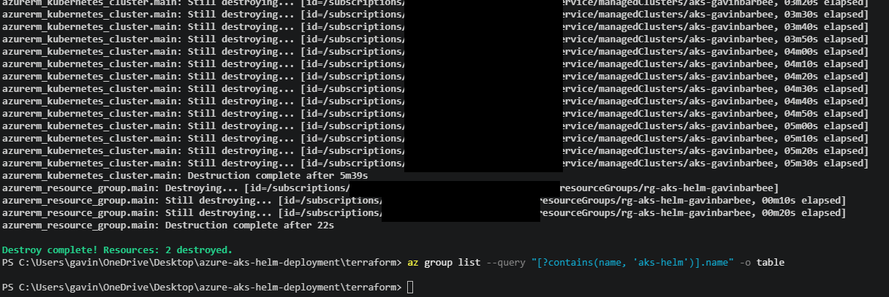

The chart files stay on disk, so `terraform apply` plus one `helm upgrade --install` rebuilds the entire environment.

## 💡 Key Takeaways

- **"Deployable" has three independent gates, and only two can be checked in advance.** Quota said 10 B-series vCPUs were free, yet the size was blocked for my subscription in every region I tried. Then a size that passed both availability and quota still failed because AKS itself had no capacity in that region. Checking `az vm list-skus --all` and per-family quota before `apply` caught the first two, and making `location` a variable meant surviving the third was a one-line change.
- **A clean `terraform plan` after apply is the real finish line.** The apply succeeded, but the next plan wanted to strip a surge setting AKS fills in on its own. Left alone, every future plan would show a change that never converges. Declaring the platform's value got the plan to "No changes."
- **Helm turns a deployment into one versioned unit.** A config-only change rolled the pods automatically through the checksum annotation, and one `helm rollback` restored the whole release, down to the same ReplicaSet hash as revision 1. The rollback became revision 3, so the audit trail keeps every change, including the undo.
- **Prove behavior with cluster state, not the app's surface.** whoami never displays the config value, so the ConfigMap contents and new pod names were the proof. The HPA held at 2 replicas under load because CPU reached 45% against a 60% target; that's the autoscaler working as designed, and understanding the trigger matters more than forcing a scale-out.
- **Know the platform's edges.** Azure's load balancer health-probes ingress-nginx at `/` by default, where it returns 404, so a single annotation decides whether the public IP works at all. The controller itself is retired, and because the chart only references `ingress.className`, moving to a maintained controller doesn't touch the chart.

**The business value:** everything in this project was destroyed at the end and can be rebuilt from this repo with one `terraform apply` and two Helm commands. Environments deploy from the same chart with only values changing, so they stop drifting, and a bad release is a one-command rollback instead of an incident.

---

**Author:** Gavin Barbee | **Project:** Deploying a Web App to AKS with Helm | **Difficulty:** Intermediate | **Time to Complete:** TBD (updated after the build)